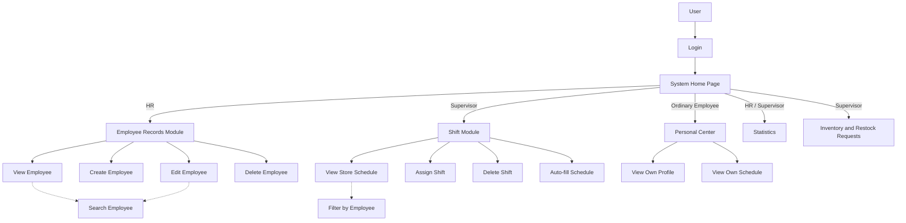

# 用例说明

## 1. System Overall Overview

梅提商城员工管理系统是门店内部使用的员工管理工具。访客完成登录后进入 System Home Page，系统根据账号角色分流：

- HR 进入员工档案模块，负责人事资料的查询、新增、编辑和删除，同时可以查看部门、班次、统计与账号角色。
- Supervisor 进入门店管理模块，负责查询员工、分配班次、查看统计和库存。
- Ordinary Employee 进入个人中心，只能查看本人档案与本人班次。

系统使用统一角色术语：`HR`、`Supervisor`、`Ordinary Employee`。所有账号在登录前统称 `User`。不存在 `Administrator`、`Admin` 或含义模糊的“管理员”角色。

## 2. Use Case Diagram

`Search Employee` 被 `View Employee` 与 `Edit Employee` 包含，使用 `<<include>>` 关系表示。`Filter by Employee` 被门店班次查看包含。

## 3. Detailed Use Cases

### UC-01 Login

- **Actor:** User
- **Precondition:** 系统已完成初始化，账号已存在。
- **Trigger:** User 打开系统入口。
- **Main Scenario:**
  1. User 输入账号和密码。
  2. 系统校验账号、密码摘要和会话状态。
  3. 系统确认账号角色。
  4. 系统进入 System Home Page，并按角色显示导航。
- **Extensions:**
  - 1A. 账号或密码为空：系统提示补全。
  - 1B. 账号或密码错误：系统显示统一错误信息，不暴露账号是否存在。
  - 1C. 会话超过 8 小时：系统要求重新登录。

### UC-02 View Employee

- **Actor:** HR, Supervisor
- **Precondition:** User 已登录，且角色为 HR 或 Supervisor。
- **Trigger:** User 选择“员工档案”或“员工查询”。
- **Main Scenario:**
  1. 系统加载员工列表。
  2. 系统显示姓名、工号、部门、岗位、联系方式、时薪和状态。
  3. User 选择一名员工。
  4. 系统显示员工详情、近期出勤和近期班次。
- **Extensions:**
  - 1A. 没有员工数据：系统显示空状态。
  - 1B. 数据加载失败：系统提示稍后重试，并保留当前页面。

### UC-03 Search Employee

- **Actor:** HR, Supervisor
- **Precondition:** User 已进入员工列表。
- **Trigger:** User 输入关键字或选择筛选条件。
- **Main Scenario:**
  1. 系统按姓名、工号、电话、邮箱、岗位或地址匹配关键字。
  2. 系统应用部门与状态筛选。
  3. 系统更新结果数量和员工列表。
- **Extensions:**
  - 1A. 没有匹配结果：系统显示空状态和“清除筛选”按钮。
  - 1B. 搜索词包含空格：系统去除首尾空格后匹配。

### UC-04 Create Employee

- **Actor:** HR
- **Precondition:** User 已登录且角色为 HR。
- **Trigger:** HR 点击“添加员工”。
- **Main Scenario:**
  1. 系统显示员工信息表单。
  2. HR 填写姓名、工号、手机、邮箱、部门、岗位、时薪、入职日期、状态和地址。
  3. HR 点击“添加员工”。
  4. 系统校验必填项、工号唯一性和字段格式。
  5. 系统保存档案并写入操作记录。
  6. 系统刷新员工列表并显示成功消息。
- **Extensions:**
  - 1A. 必填字段为空：系统在对应字段下提示。
  - 1B. 工号重复：系统阻止保存并提示更换工号。
  - 1C. 手机、邮箱或时薪格式错误：系统标出具体字段。
  - 1D. Supervisor 或 Ordinary Employee 访问：系统拒绝操作。

### UC-05 Edit Employee

- **Actor:** HR
- **Precondition:** 员工档案存在，User 角色为 HR。
- **Trigger:** HR 选择“编辑”。
- **Main Scenario:**
  1. 系统打开已填充的员工表单。
  2. HR 修改信息并保存。
  3. 系统重新校验字段与工号唯一性。
  4. 系统更新档案并写入操作记录。
- **Extensions:**
  - 1A. 员工已被其他操作删除：系统提示档案不存在并返回列表。
  - 1B. 修改后信息不合法：系统保留输入并显示字段错误。

### UC-06 Delete Employee

- **Actor:** HR
- **Precondition:** 员工档案存在，User 角色为 HR。
- **Trigger:** HR 选择“删除”。
- **Main Scenario:**
  1. 系统显示确认对话框，并列出员工姓名和工号。
  2. HR 确认删除。
  3. 系统删除员工档案。
  4. 系统保留历史班次，但员工列表不再显示该档案。
  5. 系统写入删除记录并刷新页面。
- **Extensions:**
  - 1A. HR 取消：系统关闭对话框，不修改数据。
  - 1B. Supervisor 尝试删除：系统拒绝操作。

### UC-07 Assign Shift

- **Actor:** Supervisor
- **Precondition:** User 角色为 Supervisor，存在在职员工。
- **Trigger:** Supervisor 点击“分配班次”或周视图中的“分配”。
- **Main Scenario:**
  1. 系统显示员工、日期、班次、岗位和备注字段。
  2. Supervisor 选择员工与上午、下午或晚班。
  3. 系统检查员工状态和重复班次。
  4. 系统保存班次并刷新周视图。
  5. 系统写入操作记录。
- **Extensions:**
  - 1A. 员工处于休假或离职状态：系统阻止分配。
  - 1B. 同一员工在同一天重复进入同一班次：系统阻止保存。
  - 1C. HR 或 Ordinary Employee 访问：系统不显示分配按钮。

### UC-08 View Store Schedule

- **Actor:** HR, Supervisor
- **Precondition:** User 已登录且具有班次查看权限。
- **Trigger:** User 打开班次页面。
- **Main Scenario:**
  1. 系统按周显示七天和三个班次。
  2. 系统在每个时段显示当班员工与岗位。
  3. User 可以切换上一周、下一周、本周或按员工筛选。
  4. User 点击班次查看详情。
- **Extensions:**
  - 1A. 某一周没有班次：系统显示空白时段。
  - 1B. 同一时段多人值班：系统纵向显示全部班次卡片。

### UC-09 Auto-fill Schedule

- **Actor:** Supervisor
- **Precondition:** 当前周存在未达到建议人数的班次。
- **Trigger:** Supervisor 点击“智能补齐”。
- **Main Scenario:**
  1. 系统计算本周班次缺口。
  2. 系统选择当日未排班、本周班次较少的在职员工。
  3. 系统生成上午和下午各 2 人、晚班 1 人的建议。
  4. Supervisor 确认后保存建议班次。
  5. 系统刷新排班并写入操作记录。
- **Extensions:**
  - 1A. 本周没有缺口：系统提示无需补齐。
  - 1B. 可选员工不足：系统只生成能够满足的班次。

### UC-10 View Statistics

- **Actor:** HR, Supervisor
- **Precondition:** User 已登录。
- **Trigger:** User 打开“人员统计”。
- **Main Scenario:**
  1. 系统汇总员工总数、在职率、休假人数和本周工时。
  2. 系统展示员工状态占比、部门分布、部门时薪合计和班次覆盖。
- **Extensions:**
  - 1A. 员工总数为零：系统显示空图表并提示录入员工。

### UC-11 View Inventory and Restock Requests

- **Actor:** Supervisor
- **Precondition:** User 角色为 Supervisor。
- **Trigger:** User 打开“库存查看”。
- **Main Scenario:**
  1. 系统显示商品名称、SKU、货架、当前库存和安全库存。
  2. 系统标记库存正常、库存偏低或缺货。
  3. 系统显示补货申请、申请人、数量和状态。
  4. User 可以按商品分类筛选库存。
- **Extensions:**
  - 1A. 分类下没有商品：系统显示空状态。
  - 1B. 库存低于安全库存：系统显示预警标签。

### UC-12 View Own Profile

- **Actor:** Ordinary Employee
- **Precondition:** User 角色为 Ordinary Employee，且账号关联员工档案。
- **Trigger:** User 登录或打开“我的资料”。
- **Main Scenario:**
  1. 系统只加载当前账号关联的员工档案。
  2. 系统显示联系信息、岗位、部门、直属主管和近期出勤。
- **Extensions:**
  - 1A. 账号未关联档案：系统提示联系 HR。
  - 1B. Ordinary Employee 尝试查看其他员工：系统拒绝访问。

### UC-13 View Own Schedule

- **Actor:** Ordinary Employee
- **Precondition:** User 角色为 Ordinary Employee。
- **Trigger:** User 打开“我的班次”。
- **Main Scenario:**
  1. 系统过滤出当前员工的班次。
  2. 系统按周显示日期、班次时段和岗位。
  3. User 可以切换周。
- **Extensions:**
  - 1A. 当前周没有班次：系统显示“无排班”。
  - 1B. Ordinary Employee 尝试删除或修改班次：系统不提供相关操作。

### UC-14 Modify Account Role

- **Actor:** HR
- **Precondition:** User 角色为 HR，目标账号不是当前登录账号。
- **Trigger:** HR 在“角色与权限”页面点击账号对应的编辑按钮。
- **Main Scenario:**
  1. 系统显示可选角色：HR、Supervisor、Ordinary Employee。
  2. HR 选择新角色并保存。
  3. 系统更新账号角色并写入操作记录。
  4. 目标账号下次进入页面时按新角色显示权限。
- **Extensions:**
  - 1A. HR 尝试修改本人角色：系统阻止操作，避免当前会话失去管理入口。
  - 1B. 目标账号不存在：系统提示并刷新账号列表。
