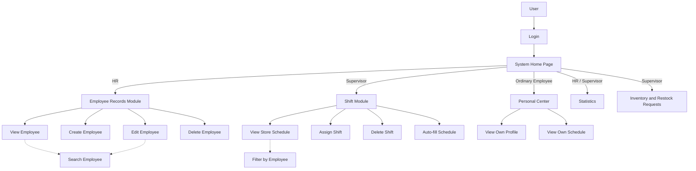

# Use Cases

## 1. System Overall Overview

Meiti Mall Employee Management is an internal store tool for employee records, shift planning, workforce statistics, and role-based access. A visitor signs in and enters the System Home Page. The system then routes the account by role:

- HR enters the employee records module and can search, add, edit, and delete personnel records. HR can also view departments, shifts, statistics, and account roles.
- Supervisor enters the store management area and can search employees, assign shifts, view statistics, and review inventory.
- Ordinary Employee enters the personal center and can only view their own profile and shifts.

The system uses three consistent role names: `HR`, `Supervisor`, and `Ordinary Employee`. An unauthenticated account is called a `User`. The system does not use `Administrator`, `Admin`, or an ambiguous “manager” role.

## 2. Use Case Diagram

`Search Employee` is included by `View Employee` and `Edit Employee`, represented by the `<<include>>` relationship. `Filter by Employee` is included by the store schedule view.

## 3. Detailed Use Cases

### UC-01 Login

- **Actor:** User
- **Precondition:** The system is initialized and the account exists.
- **Trigger:** The User opens the system entry page.
- **Main Scenario:**
  1. The User enters a username and password.
  2. The system verifies the account, password digest, and session state.
  3. The system confirms the account role.
  4. The system opens the System Home Page and displays navigation for that role.
- **Extensions:**
  - 1A. The username or password is empty: the system asks the User to complete both fields.
  - 1B. The credentials are incorrect: the system displays one generic error without revealing whether the account exists.
  - 1C. The session is older than eight hours: the system requires the User to sign in again.

### UC-02 View Employee

- **Actor:** HR, Supervisor
- **Precondition:** The User is signed in as HR or Supervisor.
- **Trigger:** The User selects Employee Records or Employee Directory.
- **Main Scenario:**
  1. The system loads the employee list.
  2. The system displays name, employee ID, department, position, contact details, hourly rate, and status.
  3. The User selects an employee.
  4. The system displays the employee record, recent attendance, and upcoming shifts.
- **Extensions:**
  - 1A. No employee records exist: the system displays an empty state.
  - 1B. Data cannot be loaded: the system asks the User to try again and keeps the current page.

### UC-03 Search Employee

- **Actor:** HR, Supervisor
- **Precondition:** The User is on the employee list.
- **Trigger:** The User enters a keyword or selects a filter.
- **Main Scenario:**
  1. The system matches the keyword against name, employee ID, phone, email, position, or address.
  2. The system applies the department and status filters.
  3. The system updates the result count and employee list.
- **Extensions:**
  - 1A. No records match: the system displays an empty state and a Clear Filters button.
  - 1B. The search value contains leading or trailing spaces: the system trims them before matching.

### UC-04 Create Employee

- **Actor:** HR
- **Precondition:** The User is signed in as HR.
- **Trigger:** HR selects Add Employee.
- **Main Scenario:**
  1. The system displays the employee form.
  2. HR enters name, employee ID, mobile, email, department, position, hourly rate, hire date, status, and address.
  3. HR selects Add Employee.
  4. The system validates required fields, employee ID uniqueness, and field formats.
  5. The system saves the record and writes an activity entry.
  6. The system refreshes the employee list and displays a success message.
- **Extensions:**
  - 1A. A required field is empty: the system displays an error below that field.
  - 1B. The employee ID already exists: the system blocks the save and asks for another ID.
  - 1C. The phone, email, or hourly rate is invalid: the system identifies the affected field.
  - 1D. A Supervisor or Ordinary Employee attempts the action: the system rejects it.

### UC-05 Edit Employee

- **Actor:** HR
- **Precondition:** The employee record exists and the User is signed in as HR.
- **Trigger:** HR selects Edit.
- **Main Scenario:**
  1. The system opens the employee form with existing values.
  2. HR changes the information and saves.
  3. The system revalidates the fields and employee ID uniqueness.
  4. The system updates the record and writes an activity entry.
- **Extensions:**
  - 1A. The employee was deleted by another operation: the system reports that the record is unavailable and returns to the list.
  - 1B. The changed data is invalid: the system keeps the entered values and displays field errors.

### UC-06 Delete Employee

- **Actor:** HR
- **Precondition:** The employee record exists and the User is signed in as HR.
- **Trigger:** HR selects Delete.
- **Main Scenario:**
  1. The system displays a confirmation dialog with the employee name and ID.
  2. HR confirms deletion.
  3. The system deletes the employee record.
  4. Historical shifts remain, but the record no longer appears in the employee list.
  5. The system writes a deletion entry and refreshes the page.
- **Extensions:**
  - 1A. HR cancels: the system closes the dialog without changing data.
  - 1B. A Supervisor attempts deletion: the system rejects the action.

### UC-07 Assign Shift

- **Actor:** Supervisor
- **Precondition:** The User is signed in as Supervisor and at least one active employee exists.
- **Trigger:** The Supervisor selects Assign Shift or Assign in the weekly view.
- **Main Scenario:**
  1. The system displays employee, date, shift, station, and notes fields.
  2. The Supervisor selects an employee and a morning, afternoon, or evening shift.
  3. The system checks employee status and duplicate assignments.
  4. The system saves the shift and refreshes the weekly view.
  5. The system writes an activity entry.
- **Extensions:**
  - 1A. The employee is on leave or inactive: the system blocks assignment.
  - 1B. The employee already has the same shift on that date: the system blocks the save.
  - 1C. HR or an Ordinary Employee attempts access: the system does not display the assignment controls.

### UC-08 View Store Schedule

- **Actor:** HR, Supervisor
- **Precondition:** The User is signed in with schedule-view permission.
- **Trigger:** The User opens Scheduling or Shift View.
- **Main Scenario:**
  1. The system displays seven days and three daily shifts by week.
  2. The system displays assigned employees and stations for each period.
  3. The User can move to the previous week, next week, current week, or filter by employee.
  4. The User selects a shift to view its details.
- **Extensions:**
  - 1A. A week has no shifts: the system displays empty time slots.
  - 1B. Multiple employees work the same period: the system stacks all shift cards vertically.

### UC-09 Auto-fill Schedule

- **Actor:** Supervisor
- **Precondition:** At least one shift in the current week is below the recommended coverage.
- **Trigger:** The Supervisor selects Auto-Fill.
- **Main Scenario:**
  1. The system calculates the shift gaps for the week.
  2. The system selects active employees who are not scheduled that day and have fewer weekly shifts.
  3. The system targets two people for morning and afternoon and one for evening.
  4. The Supervisor confirms the suggestions.
  5. The system saves the shifts, refreshes the schedule, and writes an activity entry.
- **Extensions:**
  - 1A. There are no gaps: the system reports that the schedule already meets the recommended coverage.
  - 1B. Too few employees are available: the system generates only the assignments it can fill.

### UC-10 View Statistics

- **Actor:** HR, Supervisor
- **Precondition:** The User is signed in.
- **Trigger:** The User opens Statistics.
- **Main Scenario:**
  1. The system summarizes total employees, active rate, employees on leave, and weekly hours.
  2. The system displays employee-status share, department headcount, department hourly-rate totals, and shift coverage.
- **Extensions:**
  - 1A. The employee total is zero: the system displays empty charts and asks the User to add employees.

### UC-11 View Inventory and Restock Requests

- **Actor:** Supervisor
- **Precondition:** The User is signed in as Supervisor.
- **Trigger:** The User opens Inventory.
- **Main Scenario:**
  1. The system displays product name, SKU, shelf, on-hand stock, and safety stock.
  2. The system marks each item as In Stock, Low Stock, or Out of Stock.
  3. The system displays restock requests, requester, quantity, and status.
  4. The User can filter inventory by product category.
- **Extensions:**
  - 1A. A category has no products: the system displays an empty state.
  - 1B. Stock is below safety stock: the system displays a warning label.

### UC-12 View Own Profile

- **Actor:** Ordinary Employee
- **Precondition:** The User is signed in as Ordinary Employee and the account is linked to an employee record.
- **Trigger:** The User signs in or opens My Profile.
- **Main Scenario:**
  1. The system loads only the employee record linked to the current account.
  2. The system displays contact details, position, department, manager, and recent attendance.
- **Extensions:**
  - 1A. The account is not linked to an employee record: the system asks the User to contact HR.
  - 1B. An Ordinary Employee attempts to view another employee: the system denies access.

### UC-13 View Own Schedule

- **Actor:** Ordinary Employee
- **Precondition:** The User is signed in as Ordinary Employee.
- **Trigger:** The User opens My Shifts.
- **Main Scenario:**
  1. The system filters shifts for the current employee.
  2. The system displays date, shift period, and station by week.
  3. The User can switch weeks.
- **Extensions:**
  - 1A. The current week has no shifts: the system displays No shift.
  - 1B. An Ordinary Employee attempts to edit or delete a shift: the system provides no such controls.

### UC-14 Change Account Role

- **Actor:** HR
- **Precondition:** The User is signed in as HR and the target account is not the current account.
- **Trigger:** HR selects the edit action for an account on the Roles & Access page.
- **Main Scenario:**
  1. The system displays the available roles: HR, Supervisor, and Ordinary Employee.
  2. HR selects a new role and saves.
  3. The system updates the account role and writes an activity entry.
  4. The target account uses the new permissions the next time it enters the workspace.
- **Extensions:**
  - 1A. HR attempts to change the current account role: the system blocks the action so the current session does not lose its administrative entry point.
  - 1B. The target account no longer exists: the system reports the issue and refreshes the account list.
